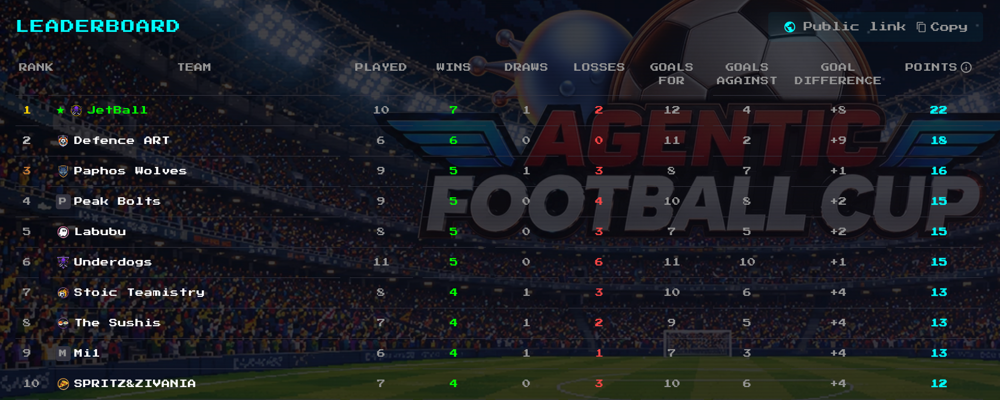

# AWS FOOTBALL CUP CYPRUS
Last gameplay looked like that:
- team plays some strategy (1 out of 6)
- coach(me), which can say someting every tick of the game(2), sends commands 
    - C1-C6 for short commands like attack,defend,tackle
    - S1-S7 to switch strategies like HIGH_PRESS, ALL_OUT

## Results
- 5 matches in a row won
- 1st place overall in a table, but unfortunately we did not get out of the first group, as the other team had the same score in points, but their goal difference was bigger ((
- anyway, it was fun, the food was good =)

https://lb.agentic-football.aws.dev/e/eji-RuHkmxoWTWe7/